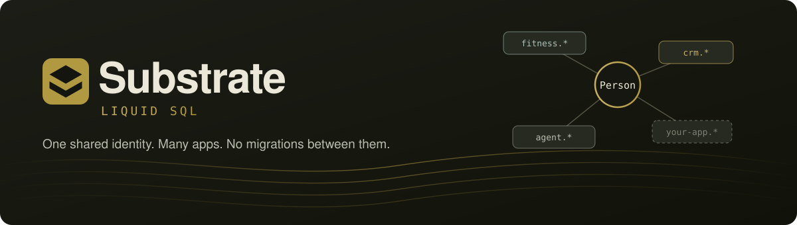
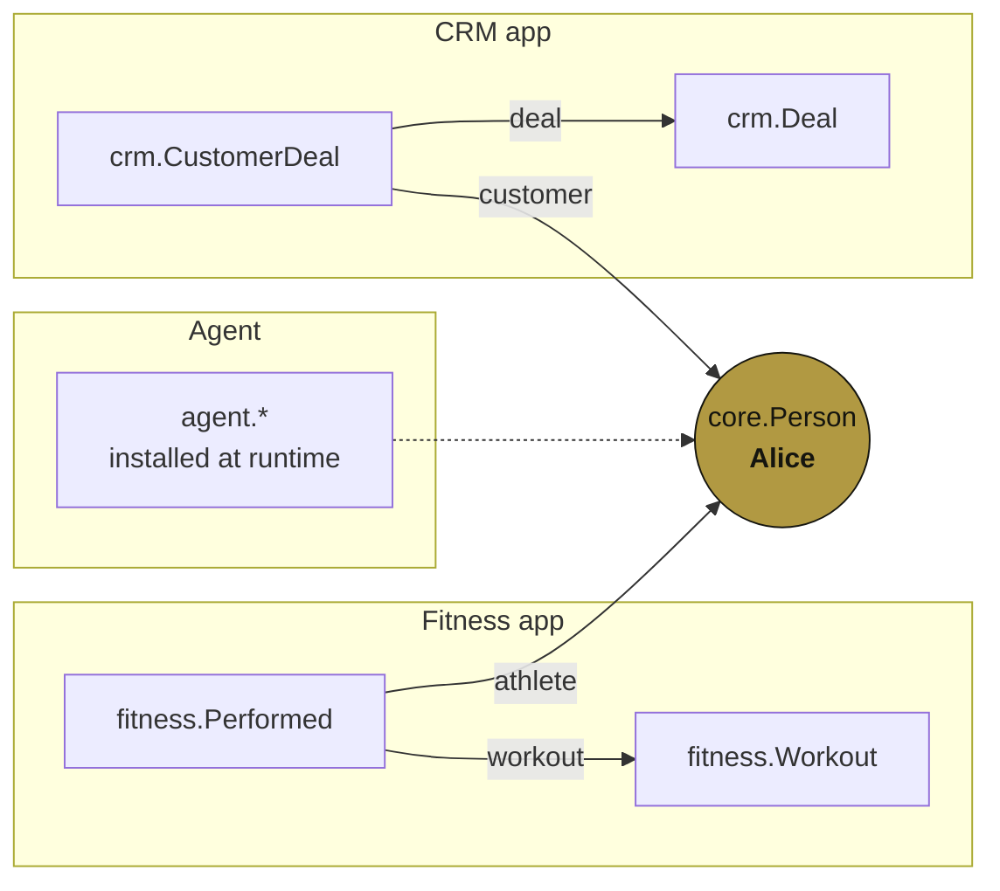
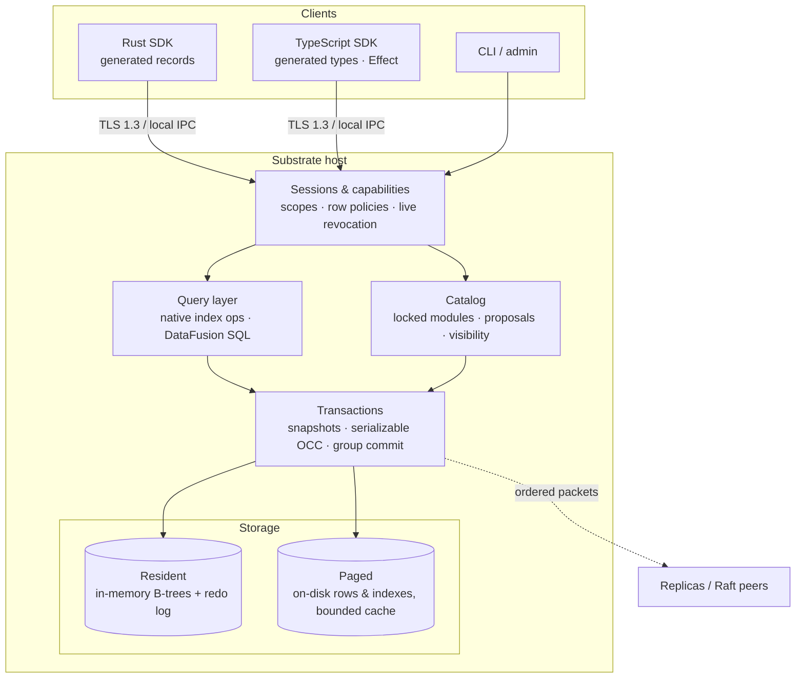

<p align="center">
  
</p>

<p align="center">
  
  
  
  
  
</p>

<p align="center">
  <a href="#quick-start">Quick start</a> ·
  <a href="#how-it-works">How it works</a> ·
  <a href="#demos">Demos</a> ·
  <a href="#status">Status</a> ·
  <a href="#documentation">Docs</a>
</p>

---

**Substrate** is a transactional relational database for independent apps and agents that **share stable identities**.

A fitness app attaches a workout to a person. A CRM attaches a deal to the same person. Each app has its own typed schema and its own permissions, and neither one rewrites the person or migrates the other's records. Sharing an identity **does not** grant access to everything attached to it.



Good fits: personal data platforms, extensible business apps, plugin ecosystems, and agent tools that discover or add narrowly authorized schemas while other apps keep running.

## Highlights

| | |
| --- | --- |
| 🧬 **Composable schemas** | Additive modules attach new relations to existing identities. Installs happen online, with no downtime and no cross-app migrations. |
| 🔐 **Isolation by default** | Per-app ownership, scoped credentials, row filters, delegation and **live, cascading revocation**. |
| 🧾 **Typed everywhere** | Generated Rust records and TypeScript types and validators (Standard Schema V1). A typed query builder and batched nested reads. |
| 🗄️ **Real SQL** | DataFusion SQL over authorized native indexes, plus joins, aggregates, windows, `EXPLAIN ANALYZE` and bounded DML. |
| 💾 **Durable** | Serializable optimistic transactions, group commit, checkpoints with a bounded redo tail, and crash and fault testing. |
| 📀 **Larger than RAM** | An opt-in paged engine keeps rows, indexes and identities on disk with bounded caches. |
| 🌐 **Remote** | A TLS 1.3 host with a Node client, credential rotation and persistent sessions. Replication and an optional Raft consensus feature are also available. |

## Quick start

Requires **Rust 1.94+** and **Node 20+**. OpenSSL is needed only for `demo:remote`.

```sh
git clone git@github.com:hypen-lang/substrate.git && cd substrate

cargo run -- demo                 # in-memory end-to-end demo
npm ci && npm run demo:processes  # host and two independent apps, using TypeScript
```

The demo installs `core.Person`, adds Alice, installs **Fitness** and **CRM** independently, and attaches data from both apps to her:

```sql
SELECT p.name, w.durationMinutes, d.amount
FROM core.Person p
JOIN fitness.Performed f ON f.athlete  = p.id
JOIN fitness.Workout   w ON w.id       = f.workout
JOIN crm.CustomerDeal  c ON c.customer = p.id
JOIN crm.Deal          d ON d.id       = c.deal;
```

```text
 name  | durationMinutes | amount
-------+-----------------+--------
 Alice |              45 | 125050     -- decimal(scale 2): 1250.50 as exact minor units
```

Fitness **cannot** read CRM's private relations. An admin can explicitly grant a reporting principal access to both.

<details>
<summary>Persist and inspect a database from the CLI</summary>

```sh
cargo run -- demo       /tmp/substrate-demo.redb   # requires a fresh file
cargo run -- inspect    /tmp/substrate-demo.redb
cargo run -- checkpoint /tmp/substrate-demo.redb
cargo run -- query      /tmp/substrate-demo.redb fitness 'SELECT name FROM core.Person'
```

Add `--paged` to `serve`, `serve-tls`, `query` and manifest commands to use the disk-backed engine.

> [!WARNING]
> The CLI is a local **administrator** tool, and choosing a principal there is not authentication. Only trusted host code should hold a `Database`. Give each app its own restricted `Session`.

</details>

## Code

<table>
<tr><th>Rust</th><th>TypeScript</th></tr>
<tr valign="top"><td>

```rust
use substrate_liquid::{demo, Database, Grant, Result};

fn main() -> Result<()> {
    let db = Database::memory(); // or Database::open("app.redb")

    // Host: install core, grant Fitness its namespace
    let mut tx = db.admin().transaction();
    tx.install(demo::core())?;
    let alice = tx.insert("core.Person", vec!["Alice".into()])?;
    tx.grant_schema("fitness", "fitness")?;
    tx.grant("fitness", "core.Person", Grant {
        reference: true, ..Grant::read_only()
    })?;
    tx.commit()?;

    // App: install its own schema, link to Alice
    let fitness = db.session("fitness");
    let mut tx = fitness.transaction();
    tx.install(demo::fitness())?;
    let w = tx.insert("fitness.Workout", vec![45.into()])?;
    tx.insert("fitness.Performed", vec![alice.into(), w.into()])?;
    tx.commit()?;

    // Query natively or with SQL
    let snap = fitness.snapshot();
    let sql = snap.sql()?;
    let mut q = sql.prepare("SELECT durationMinutes FROM fitness.Workout")?;
    println!("{:?}", q.query(&[])?.rows);
    Ok(())
}
```

</td><td>

```ts
import { RemoteClient } from "./sdk/typescript/client.mjs";
import { Person } from "./generated/schema.js";

const client = new RemoteClient({
  host: "db.internal",
  port: 7443,
  servername: "db.internal",
  ca: trustedCaPem,
}, credential);

const id = await client.insert(Person, { name: "Ada" });
const people = await client.page(Person);
```

Generated types: `Person`, `PersonInsert`, `PersonUpdate`, `PersonRead`, with strict runtime validators. Exact integers, decimals and timestamps use `bigint`.

The client supports named writes, atomic batches, bounded pages, parameterized SQL and an [Effect 3 service](docs/EFFECT.md).

</td></tr>
</table>

Schemas can be written in TypeScript, with Rust builders, or as JSON. All three compile into the same validated model. **Lock** them for reproducible IDs, then generate clients:

```sh
cargo run -- schema-lock      examples/dx/schema.json examples/dx/manifest.json
cargo run -- manifest-install /tmp/schema-demo.redb examples/dx/manifest.json
cargo run -- manifest-export  /tmp/schema-demo.redb installed.json
cargo run -- generate         installed.json generated fitness@1
```

## How it works



- **Data model.** Everything is a typed relationship over UUID identities: entity records, properties, links, and relations with any number of participants. An optional property is its own relation, not a new column on someone else's table.
- **Authorization first.** Inputs are filtered and reference visibility is enforced *before* native joins or SQL aggregates run. Permissions are rechecked live before results are released.
- **SQL.** [DataFusion](docs/DATAFUSION-SQL.md) runs over lazy, authorized native-index providers. Eligible queries use index probes, range and top-k pushdown, and compiled point reads. No query silently falls back to another engine.
- **Durability.** Commits group into shared redb writes. Checkpoints trigger automatically at **128 tail commits or 8 MiB**, and recovery replays only the bounded tail. See [checkpoints](docs/adr/005-checkpoints.md) and [background checkpoints](docs/BACKGROUND-CHECKPOINTS.md).

### Storage modes

| | Resident `Database` (default) | Paged `PagedDatabase` (opt-in) |
| --- | --- | --- |
| Current data | In memory, checkpointed to disk | On disk, with bounded caches |
| Working set | Must fit in RAM | Can exceed RAM |
| SQL, SDKs, TLS | ✅ | ✅ |
| Peak client RSS at 1M rows* | ~1.7–2.2 GiB | ~33–45 MiB |
| Conversion | — | Explicit only, with `import_resident_file` |

<sub>*From the [1M-record benchmark](docs/benchmarks/latest/README.md). Results depend on the workload.</sub>

## Demos

| Command | What it shows |
| --- | --- |
| `cargo run -- demo` | Cross-app identity, isolation, joined SQL and retained snapshots |
| `cargo run --example dx` | Generated Rust records and retry helpers |
| `npm run demo:processes` | Host and two apps, with schema discovery, typed joins, nested reads, and a kill and reopen |
| `npm run demo:schema` | Namespaces, approval flow, online install, and runtime descriptors |
| `npm run demo:security` | Capability delegation, row filters, and cascading live revocation |
| `npm run demo:remote` | TLS 1.3 host, credential rotation, revocation and expiry |
| `npm run demo:effect` | Effect 3 service with typed errors and atomic batches |
| `npm run demo:paged` | Paged engine behind TypeScript over TLS |
| `cargo run --example datafusion_sql` | SQL joins and aggregates, native lookup, live revocation |
| `cargo run --example paged_sql` | Joins and aggregates on paged storage |
| `cargo run --example schema_visibility` | Public, authenticated and private relation families |
| `cargo run --example nullable_references` | NULLs, floats, cascades and deferred foreign keys |
| `cargo run --example sql_writes` | Transactional SQL `INSERT` / `UPDATE` / `DELETE` |
| `cargo run --example durable_views` | Durable read-only invoker views |
| `cargo run --example shared_reads` | Zero-copy authorized reads under revocation |
| `cargo run --features consensus --example consensus_failover` | Raft quorum writes and leader failover |

## Performance

Warm prepared admin reads at 20,000 people and 180,000 occurrences, median in µs:

| Query | Substrate | Direct SQLite |
| --- | ---: | ---: |
| Identity lookup | 0.450 | 0.429 |
| Relationship lookup | 1.475 | 1.317 |
| Five-family selective join | 4.221 | 3.188 |
| Grouped join / top 25 | **14,156** | 42,022 |
| Nested window / top 1 | **9,080** | 26,476 |

> [!NOTE]
> SQLite does none of Substrate's authorization or reference-closure checks. These numbers are workload-specific. See the [latest 1M-record comparison against SQLite and PostgreSQL](docs/benchmarks/latest/README.md), [performance history](docs/PERFORMANCE-HISTORY.md), and the [performance CI gate](tools/perf/README.md).

## Status

> [!IMPORTANT]
> Substrate is a **research prototype** with a single-node default. Production operations, distributed infrastructure, storage footprint and broad analytical scans still need work. The SDKs are repository packages and are not yet published to npm or crates.io.

| Area | ✅ Working | 🚧 Not yet |
| --- | --- | --- |
| Kernel | UUID identities, typed n-ary occurrences, references to occurrences | Schema morphisms, identity merging |
| Values | bool, i64, text, refs, fixed decimals, µs timestamps, bytes, nullables, finite floats | Arbitrary-precision decimals, NaN/∞ |
| Constraints | Uniqueness, checks, typed refs, RESTRICT/CASCADE, deferred FKs | Cardinality bounds, deferred unique/CHECK |
| Transactions | Atomic installs, writes and grants, snapshots, serializable OCC, group commit | Parallel physical writes, distributed transactions |
| Storage | Resident + checkpointed redo; paged engine; replication | Paged named views, auto-repacking legacy files |
| Queries | Indexed ranges, joins, top-k, DataFusion SQL, SQL DML, typed TS joins | Text ranges, cost-based planning |
| Views | Snapshot-local and durable invoker views | Remote view API, materialized views |
| Security | TLS 1.3, scoped credentials, rotation, row policies, live revocation, audit events | OIDC/enrollment, field policies, ReBAC, durable audit |
| Tooling | Locked manifests, TS/Rust codegen, Effect, catalog, proposals | Published packages, approval UI, studio |
| Verification | Property, concurrency, SQL differential, corruption, crash and I/O fault tests | Formal proofs, exhaustive power-loss testing |

The full queue is in [missing.md](missing.md).

## Documentation

| Topic | Docs |
| --- | --- |
| **Start here** | [Architecture](docs/ARCHITECTURE.md) · [DX guide](docs/DX.md) · [DX matrix](docs/DX-MATRIX.md) · [Decisions (ADRs)](docs/adr/README.md) |
| **Schemas** | [Catalog & discovery](docs/CATALOG.md) · [Schema control](docs/SCHEMA-CONTROL.md) · [Visibility](docs/SCHEMA-VISIBILITY.md) · [Constraints](docs/CONSTRAINTS.md) · [Nullables & refs](docs/NULLABLE-AND-REFERENCES.md) |
| **Queries** | [Typed queries](docs/QUERY-DX.md) · [DataFusion SQL](docs/DATAFUSION-SQL.md) · [SQL writes](docs/SQL-WRITES.md) · [Durable views](docs/DURABLE-VIEWS.md) · [Profiling](docs/QUERY-PROFILING.md) |
| **Security** | [Security model](docs/SECURITY.md) · [Remote security](docs/REMOTE-SECURITY.md) · [Persistent transport](docs/PERSISTENT-TRANSPORT.md) |
| **Storage** | [Paged storage](docs/PAGED-STORAGE.md) · [Disk snapshots](docs/DISK-SNAPSHOTS.md) · [Incremental checkpoints](docs/INCREMENTAL-CHECKPOINTS.md) · [Group commit](docs/group-commit.md) · [Hardening](docs/OPERATIONAL-HARDENING.md) |
| **Scale-out** | [Replication](docs/REPLICATION.md) · [Paged replication](docs/PAGED-REPLICATION.md) · [Partition routing](docs/PARTITION-ROUTING.md) · [Consensus](docs/CONSENSUS.md) |
| **Integrations** | [Effect 3](docs/EFFECT.md) |
| **Performance** | [Benchmarks](docs/benchmarks/README.md) · [History](docs/PERFORMANCE-HISTORY.md) · [Native overheads](docs/NATIVE-OVERHEADS.md) · [Beyond SQL](docs/PERFORMANCE-BEYOND-SQL.md) |
| **Verification** | [Implementation report](docs/IMPLEMENTATION.md) |

## Development

```sh
cargo test
cargo clippy --all-targets -- -D warnings
npm run test:ts

cargo bench --bench sqlite            # also: recovery, nested, schema_install
tools/bench-comparison-postgres.sh    # includes PostgreSQL if installed locally
npm run profile:query -- db.redb fitness query.sql   # flamegraph via samply
```

Dependencies are pinned by `Cargo.lock`, and `--offline` works once they are cached. Pull requests run paired SQL and kernel performance checks. See the [performance CI guide](tools/perf/README.md).

## License

Dual-licensed under **MIT** or **Apache-2.0**, at your option.
